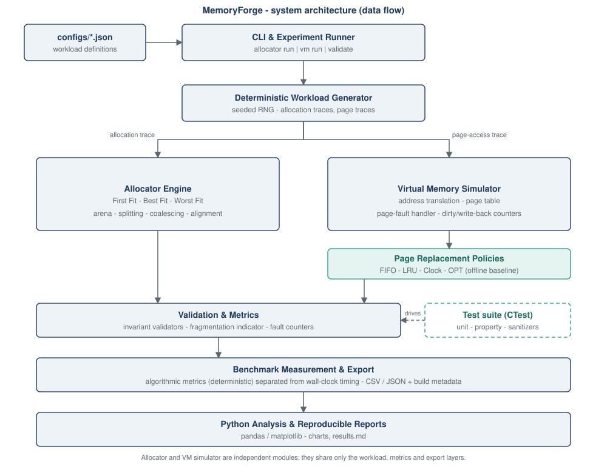
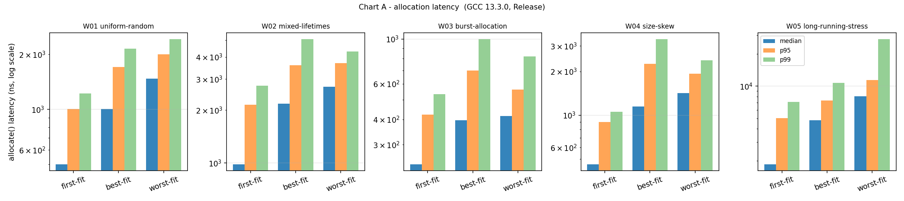
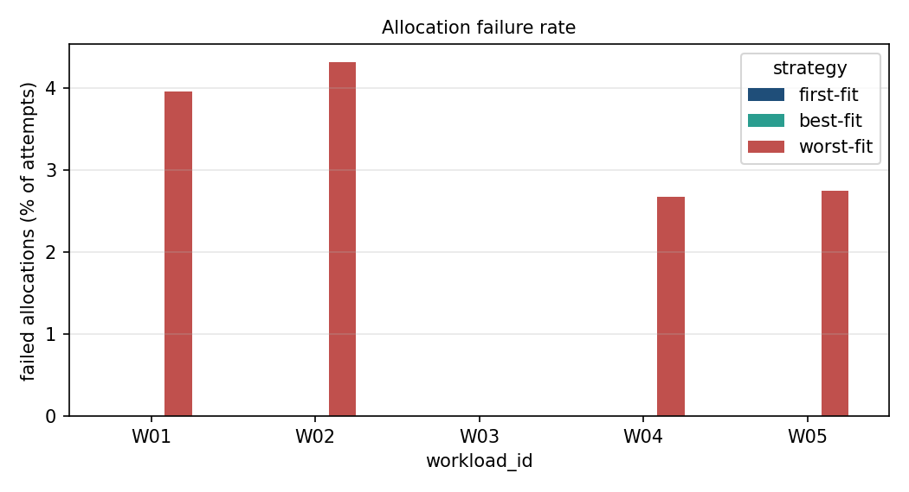

# MemoryForge

**Virtual Memory & Memory Allocator Laboratory**

A C++20 systems programming laboratory for custom memory allocation, fragmentation analysis, virtual memory simulation, and reproducible performance benchmarking.

[](LICENSE)



MemoryForge is a systems-level experimentation platform built around two independent components: a custom arena-based memory allocator and a virtual memory simulator.

Rather than presenting isolated textbook algorithms, the project implements shared execution models, deterministic workloads, invariant validation, automated tests, and structured benchmark reporting. This makes it possible to compare memory management strategies under consistent and reproducible conditions.

MemoryForge is an educational and experimental systems laboratory, not an operating system or a replacement for a production memory manager.

---

## Table of Contents

- [Core Features](#core-features)
- [System Architecture](#system-architecture)
- [Build Requirements](#build-requirements)
- [Building the Project](#building-the-project)
- [Quick Start](#quick-start)
- [Testing and Validation](#testing-and-validation)
- [Benchmark Methodology](#benchmark-methodology)
- [Experimental Results](#experimental-results)
- [Local Build and Test Evidence](#local-build-and-test-evidence)
- [Repository Structure](#repository-structure)
- [Architecture Decisions](#architecture-decisions)
- [Known Limitations](#known-limitations)
- [Roadmap](#roadmap)
- [License and Contributing](#license-and-contributing)

## Core Features

### 1. Memory Allocator Engine

A custom arena allocator supporting three allocation strategies:

- **First Fit** — selects the first free block large enough to satisfy a request.
- **Best Fit** — selects the smallest suitable free block.
- **Worst Fit** — selects the largest available free block.

All strategies share the same allocation layout and memory-management conventions, including alignment, block splitting, and immediate coalescing. This isolates the allocation-selection policy when comparing their behaviour.

Additional capabilities:

- Explicit allocation failure semantics, including `ZeroSize`, `InvalidAlignment`, `SizeOverflow`, `OutOfMemory`, `InvalidHandle`, and `DoubleFree`.
- Out-of-band allocation metadata.
- Full-state validation through `validate()` and `diagnose()`.
- Checks for memory-region tiling, overlap, alignment, coalescing, and internal accounting consistency.
- Fragmentation, allocation failure, search-step, throughput, and latency measurements.

### 2. Virtual Memory Simulator

A paging-based virtual memory simulation environment featuring:

- Virtual address translation using VPN, offset, PFN, and physical address components.
- Page tables and configurable physical frame counts.
- Page faults, dirty pages, and write-back counters.
- Four page replacement policies:
  - FIFO (First-In, First-Out)
  - LRU (Least Recently Used)
  - Clock (Second Chance)
  - OPT (Optimal Offline Replacement)

All replacement policies can process the same reference traces and frame configurations.

OPT is implemented as an offline reference policy and provides a lower-bound comparison for page faults under the same trace.

### 3. Deterministic Workload Engine

The project includes predefined allocator and virtual memory workloads.

**Allocator workloads**

| ID | Workload |
|---|---|
| W01 | Uniform random allocation |
| W02 | Mixed allocation lifetimes |
| W03 | Burst allocation |
| W04 | Size-skewed allocation |
| W05 | Long-running stress |

**Virtual memory workloads**

| ID | Workload |
|---|---|
| V01 | Sequential access |
| V02 | Repeated loop |
| V03 | Working-set shift |
| V04 | Random access |
| V05 | Adversarial cyclic access |

Workloads use deterministic seeds so that algorithmic results can be reproduced and compared across runs.

### 4. Benchmarking and Reporting

MemoryForge separates two categories of measurements:

- **Algorithmic metrics:** deterministic measurements such as allocation failures, fragmentation, search steps, page faults, and write-backs.
- **Wall-clock metrics:** machine-dependent throughput and latency measurements.

The benchmark system supports:

- Repeated execution and warm-up runs.
- CSV and JSON result export.
- Allocation time-series output.
- Build and environment metadata.
- Python-based result analysis and chart generation.

### 5. Testing and Software Quality

The project includes:

- Unit and boundary tests.
- Property-based tests using generated operation sequences.
- Independent memory-overlap validation.
- Data-pattern integrity checks.
- Regression fixtures.
- CLI integration tests.
- Configuration validation.

The test suite checks both expected outputs and internal invariants, rather than relying exclusively on example-based results.

---

## System Architecture

MemoryForge is organised around independent allocator and virtual memory subsystems.

The allocator and VM simulator do not depend on each other's internal implementation. They share the workload, metrics, and reporting infrastructure.


The main execution flow is:

1. Load and validate a workload configuration.
2. Construct the relevant allocator or virtual memory component.
3. Execute a deterministic workload.
4. Check internal invariants and execution results.
5. Collect algorithmic and timing metrics.
6. Export results to CSV and JSON.
7. Generate visualisations for analysis.

---

## Build Requirements

| Requirement | Version |
|---|---|
| C++ standard | C++20 |
| CMake | 3.25 or later |
| Compiler | MSVC, GCC 11+, or Clang 14+ |
| Python | 3.9+ for analysis scripts |
| Python packages | pandas, matplotlib |

The core C++ implementation does not require third-party runtime dependencies.

Python is only required for benchmark orchestration and chart generation.

## Building the Project

### Windows — MSVC

The project has been built and tested locally using Microsoft Visual Studio Build Tools 2026, MSVC x64, and Windows SDK.

From the repository root, configure the project:

```cmd
cmake -S . -B build/vs2026 -G "Visual Studio 18 2026" -A x64
```

Build the Release configuration:

```cmd
cmake --build build/vs2026 --config Release --parallel
```

Build the Debug configuration:

```cmd
cmake --build build/vs2026 --config Debug --parallel
```

Run the Release test suite:

```cmd
ctest --test-dir build/vs2026 -C Release --output-on-failure
```

Run the Debug test suite:

```cmd
ctest --test-dir build/vs2026 -C Debug --output-on-failure
```

The resulting executable is located at:

```text
build/vs2026/src/Release/memoryforge.exe
```

**Note:** The repository also includes CMake presets configured for Visual Studio 2022. The commands above use the Visual Studio 2026 generator used for the local verification documented in this README.

### Linux / macOS

For a single-configuration generator, the general CMake workflow is:

```bash
cmake -S . -B build -DCMAKE_BUILD_TYPE=Release
cmake --build build --parallel
ctest --test-dir build --output-on-failure
```

For sanitizer-enabled builds, the project also provides an `asan` CMake preset intended for supported GCC and Clang environments.

---

## Quick Start

After building, the CLI can be used to run allocator experiments, virtual memory simulations, validation, and trace generation.

### Display CLI Help

```cmd
build\vs2026\src\Release\memoryforge.exe --help
```

### Run an Allocator Experiment

```cmd
build\vs2026\src\Release\memoryforge.exe allocator run --config configs\allocator\mixed-lifetimes.json --strategy all --output reports\local\allocator.csv --timeseries reports\local\timeseries.csv --json reports\local\allocator.json
```

### Run a Virtual Memory Experiment

```cmd
build\vs2026\src\Release\memoryforge.exe vm run --config configs\virtual-memory\working-set-shift.json --policy all --frames 4,8,16 --output reports\local\vm.csv --json reports\local\vm.json
```

### Validate All Configurations

```cmd
build\vs2026\src\Release\memoryforge.exe validate --all
```

### Generate an Allocator Trace

```cmd
build\vs2026\src\Release\memoryforge.exe allocator trace --config configs\allocator\size-skew.json --output reports\local\allocator-trace.txt
```

### Generate a Virtual Memory Trace

```cmd
build\vs2026\src\Release\memoryforge.exe vm trace --config configs\virtual-memory\working-set-shift.json --output reports\local\vm-trace.txt
```

### Inspect Build Information

```cmd
build\vs2026\src\Release\memoryforge.exe info
```

The CLI also supports configurable strategies, frame counts, repetitions, warm-up runs, validation frequency, and output formats.

Programmatic examples are available in:

- [`examples/allocator/basic_usage.cpp`](examples/allocator/basic_usage.cpp)
- [`examples/virtual-memory/translation_demo.cpp`](examples/virtual-memory/translation_demo.cpp)

Example allocator usage:

```cpp
auto heap = make_allocator(
    AllocationStrategy::BestFit,
    1 << 20
).value();

auto block = heap->allocate(100, 64);

if (block) {
    heap->deallocate(block.value().id);
}
```

---

## Testing and Validation

MemoryForge uses CTest to execute its automated test targets.

The current test suite contains eight registered CTest entries:

| Test target | Purpose |
|---|---|
| `common_tests` | Common utilities and shared functionality |
| `allocator_tests` | Allocator behaviour and boundary conditions |
| `vm_tests` | Virtual memory and address translation |
| `workload_tests` | Workload generation and execution |
| `allocator_property_tests` | Allocator invariants under generated operations |
| `vm_property_tests` | Virtual memory properties and policy invariants |
| `cli_integration_tests` | End-to-end command-line behaviour |
| `validate_all_configs` | Validation of supplied workload configurations |

### Local Test Results

<details>
<summary><strong>Release configuration — 8/8 passed</strong></summary>


</details>

<details>
<summary><strong>Debug configuration — 8/8 passed</strong></summary>


</details>

### Configuration Validation

The `validate --all` command checks all supplied allocator and virtual memory configurations, together with built-in reference cases.

<details>
<summary><strong>Validation result — 18 passed, 0 failed</strong></summary>


</details>

The validation process includes:

- Allocator invariants and allocation/deallocation consistency.
- Coalescing and final heap-drain checks.
- Trace reproducibility.
- Virtual memory policy and frame-count checks.
- OPT lower-bound comparisons.
- Reference page-replacement cases, including Belady's anomaly.

---

## Benchmark Methodology

The benchmark methodology is documented in [`docs/experiments/benchmark-protocol.md`](docs/experiments/benchmark-protocol.md).

Each experiment separates deterministic algorithmic validation from timing measurements.

The main principles are:

1. Execute workloads on fresh allocator or simulator instances.
2. Use deterministic workload configurations and seeds.
3. Validate invariants and execution results.
4. Perform warm-up runs separately from timed repetitions.
5. Measure algorithmic metrics independently of wall-clock performance.
6. Export structured results for further analysis.

Wall-clock measurements are machine-dependent. They should be compared within the same environment and build configuration rather than treated as universal performance guarantees.

---

## Experimental Results

The following results were obtained from the local Windows/MSVC Release build.

**Environment:** Windows, MSVC 19.51, x64, Intel64 Family 6 Model 140 processor, 8 hardware threads.

The results below describe the supplied synthetic workloads. They are not claims about the performance of all allocators or real-world memory-management systems.

### 1. Allocator Strategy Comparison

The following table summarises allocation failure rates and final external fragmentation.

| Workload | First Fit: Failure / Fragmentation | Best Fit: Failure / Fragmentation | Worst Fit: Failure / Fragmentation |
|---|---:|---:|---:|
| W01 — Uniform random | 0.00% / 49.3% | 0.00% / 37.4% | 3.96% / 98.8% |
| W02 — Mixed lifetimes | 0.00% / 48.2% | 0.00% / 33.9% | 4.32% / 99.1% |
| W03 — Burst allocation | 0.00% / 13.9% | 0.00% / 13.4% | 0.00% / 95.5% |
| W04 — Size skew | 0.00% / 29.9% | 0.00% / 30.1% | 2.68% / 98.4% |
| W05 — Long-running stress | 0.00% / 56.2% | 0.00% / 48.3% | 2.75% / 99.4% |

Fragmentation is calculated as:

```text
1 - (largest_free_block / total_free_memory)
```

A higher value indicates that free memory is more fragmented.

**Observations**

- First Fit completed all five workloads without allocation failures in these experiments.
- Best Fit achieved lower final fragmentation than First Fit on W01, W02, W03, and W05, but generally required more free-block searches.
- Worst Fit produced substantially higher fragmentation in several workloads and experienced allocation failures in W02, W04, and W05.
- The results demonstrate that allocator strategy performance depends on workload characteristics and cannot be judged using a single metric.

### Allocation Latency



### Fragmentation Over Time


### Allocation Failure Rate



### 2. Virtual Memory Page Replacement

The following results illustrate the differences between FIFO, LRU, Clock, and OPT under selected reference workloads.

| Workload | Frames | FIFO | LRU | OPT | Clock |
|---|---:|---:|---:|---:|---:|
| V02 — Repeated loop | 8 | 20,000 | 20,000 | 4,452 | 20,000 |
| V03 — Working-set shift | 8 | 13,352 | 13,489 | 6,000 | 13,511 |
| V04 — Random access | 128 | 20,057 | 20,088 | 8,060 | 20,054 |
| V05 — Adversarial cyclic | 8 | 20,000 | 20,000 | 2,507 | 20,000 |
| V05 — Adversarial cyclic | 16 | 9 | 9 | 9 | 9 |

The results show that:

- OPT achieves no more page faults than the other policies for the same reference trace and frame count.
- Online policies can behave very differently depending on access patterns and available frames.
- Increasing the number of frames can substantially reduce page faults for workloads with a sufficiently small working set.
- The adversarial cyclic workload illustrates how certain access patterns can produce a large difference between online replacement policies and the offline optimum.


---

## Local Build and Test Evidence

The following screenshots document the actual local execution environment and benchmark runs.

### Allocator Benchmark


### Virtual Memory Benchmark


### Build Environment


These screenshots complement the automated test results and experimental charts. They provide evidence of successful execution on the documented local environment.

---

## Repository Structure

```text
memoryforge/
│
├── .github/             CI workflows
├── analysis/            Benchmark analysis and visualisation
├── benchmarks/          Benchmark orchestration scripts
├── configs/              Seeded allocator and VM configurations
├── docs/
│   ├── architecture/     System and component design
│   ├── decisions/        Architecture Decision Records
│   ├── experiments/     Benchmark methodology and metrics
│   └── images/
│       ├── local_run/    Local screenshots and benchmark charts
│       └── architecture.svg
│
├── examples/             Programmatic usage examples
├── include/              Public C++ headers
├── scripts/              Build and test helper scripts
├── src/                  C++ implementation and CLI
├── tests/
│   ├── unit/
│   ├── property/
│   ├── integration/
│   └── fixtures/
│
├── CMakeLists.txt
├── CMakePresets.json
├── CONTRIBUTING.md
├── LICENSE
└── README.md
```

Generated build artefacts and local benchmark outputs are excluded from version control.

---

## Architecture Decisions

The project documents its major design choices through Architecture Decision Records.

- [ADR-0001 — Language and Build](docs/decisions/ADR-0001-language-and-build.md): C++20, CMake, dependency-light implementation, and explicit error handling.
- [ADR-0002 — Allocator Layout](docs/decisions/ADR-0002-allocator-layout.md): owned arena, out-of-band metadata, and no global `malloc` replacement.

Other important design decisions:

- The allocator and VM simulator are independent components.
- Shared workloads, metrics, and reporting infrastructure support consistent experiments.
- OPT is treated as an offline reference lower bound, not as an equivalent online replacement strategy.

Further documentation:

- [System Overview](docs/architecture/system-overview.md)
- [Allocator Design](docs/architecture/allocator-design.md)
- [Virtual Memory Design](docs/architecture/virtual-memory-design.md)
- [Metrics](docs/experiments/metrics.md)
- [Benchmark Protocol](docs/experiments/benchmark-protocol.md)

---

## Known Limitations

- The allocator is single-threaded.
- Allocator metadata uses standard containers, which introduce overhead compared with an intrusive allocator design.
- The allocator uses a fixed-size arena and does not currently implement size classes or segregated free lists.
- The VM simulator uses a flat page table, a single address space, and no TLB.
- Workloads are synthetic; conclusions should not be generalised to real applications without representative traces.
- Timing results depend on the hardware, compiler, build configuration, and system load.

These limitations define the scope of the current laboratory and motivate the planned extensions.

---

## Roadmap

1. Implement a concurrent allocator variant with a dedicated benchmark protocol.
2. Introduce an intrusive-header allocator and segregated-fit strategy behind the same allocator interface.
3. Extend the VM simulator with TLB modelling and multi-level page tables.
4. Add real-world trace import for allocation logs and virtual memory access patterns.
5. Extend performance analysis with additional workload distributions and comparative metrics.

---

## License and Contributing

MemoryForge is released under the **MIT License**. See [`LICENSE`](LICENSE) for details.

Contributions, bug reports, and suggestions are welcome. See [`CONTRIBUTING.md`](CONTRIBUTING.md) for contribution guidelines.
