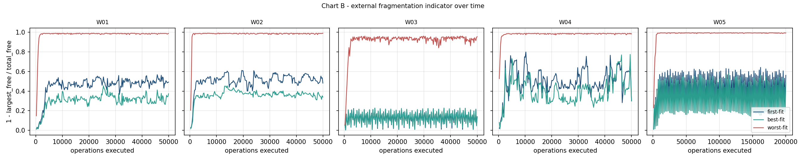
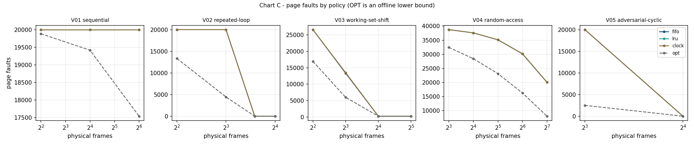

# MemoryForge

**Virtual Memory & Memory Allocator Laboratory** - a C++20 systems programming laboratory for custom memory
allocation, fragmentation analysis, virtual memory simulation, and reproducible performance benchmarking.

[](LICENSE)
<!-- After pushing to GitHub, add the CI badge with your repository path:
[](https://github.com/<user>/memoryforge/actions/workflows/ci.yml) -->


MemoryForge is not an operating system and not a collection of textbook algorithms with plots. It is a small set of
independent components - an arena allocator, a paging simulator, a deterministic workload engine - each verified by
invariant checks and tests, then measured under conditions that can be reproduced exactly.

## Features

**Allocator engine**
* Arena allocator with First Fit, Best Fit and Worst Fit that share one layout convention (alignment, splitting,
  immediate coalescing), so a comparison measures the selection rule only.
* Explicit failure semantics: `ZeroSize`, `InvalidAlignment`, `SizeOverflow`, `OutOfMemory`, `InvalidHandle`,
  `DoubleFree`. No exceptions for caller errors.
* Full-state validator (`validate()` / `diagnose()`): tiling, overlap, coalescing, alignment, counters.

**Virtual-memory simulator**
* Flat page table, address translation (`VPN`, `offset`, `PFN`, `PA`), page faults, dirty pages and write-back counters.
* FIFO, LRU, Clock (second chance) and OPT (offline lower bound), driven by identical traces and frame counts.

**Workloads and measurement**
* Allocator workloads W01-W05 and VM patterns (sequential, loop, working-set shift, random, adversarial), all seeded
  and platform-independent.
* Metrics split into *algorithmic* (deterministic) and *wall-clock* (machine-dependent); CSV and JSON export with build
  metadata; Python charts.

**Quality**
* ~60 tests: unit, property (random sequences checked against an independent model with data-pattern overlap
  detection), regression fixtures, CLI integration. Clean under AddressSanitizer + UndefinedBehaviorSanitizer.

## Build

Requirements: a C++20 compiler (MSVC 2022, GCC >= 11, Clang >= 14), CMake >= 3.25, Git. Python 3.9+ with
`pandas` and `matplotlib` only for the charts.

**Windows (Visual Studio Build Tools / MSVC)**

```powershell
.\scripts\build.ps1 -Config Release     # cmake --preset vs2022 + build
.\scripts\test.ps1  -Config Debug       # build + ctest
```

**Linux / macOS**

```bash
cmake --preset release && cmake --build --preset release
ctest --preset release
```

Without presets: `cmake -S . -B build -DCMAKE_BUILD_TYPE=Release && cmake --build build && ctest --test-dir build`.

Sanitizers (Linux/macOS, GCC or Clang): `cmake --preset asan && cmake --build --preset asan && ctest --preset asan`.

### Platform status

| Toolchain | Status |
| --- | --- |
| GCC 13, Linux, Debug / Release / ASan+UBSan, `-Wall -Wextra -Wpedantic -Wconversion -Wshadow -Werror` | built and all tests passed during development |
| MSVC, Clang, macOS | configured in `.github/workflows/ci.yml`; check the Actions tab for the current result |

## Quick start

```text
memoryforge allocator run --config configs/allocator/mixed-lifetimes.json --strategy all \
    --output reports/local/allocator.csv --timeseries reports/local/timeseries.csv --json reports/local/allocator.json

memoryforge vm run --config configs/virtual-memory/working-set-shift.json --policy lru --frames 4,8,16 \
    --output reports/local/vm.csv

memoryforge validate --all
memoryforge allocator trace --config configs/allocator/size-skew.json --output trace.txt
```

(On Windows the executable is `memoryforge.exe` under `build\vs2022\Release\`; use `^` or a backtick for line
continuation.) `memoryforge --help` lists every option. Programmatic use is shown in
[`examples/allocator/basic_usage.cpp`](examples/allocator/basic_usage.cpp) and
[`examples/virtual-memory/translation_demo.cpp`](examples/virtual-memory/translation_demo.cpp).

```cpp
auto heap = make_allocator(AllocationStrategy::BestFit, 1 << 20).value();
auto block = heap->allocate(100, 64);          // Result<AllocationHandle>
if (block) heap->deallocate(block.value().id); // Status
```

## Tests

```bash
ctest --test-dir build --output-on-failure     # unit, property, integration, validate --all
./build/tests/allocator_tests first_fit        # run one binary, optional name filter
```

| Kind | Where | Checks |
| --- | --- | --- |
| Unit / boundary | `tests/unit/` | contracts, error codes, exact fits, alignment gaps, splitting, coalescing, the strategies' differing choices, address translation, textbook fault counts (FIFO 10 / LRU 9 / OPT 7), Belady's anomaly, JSON, config validation |
| Property | `tests/property/` | thousands of random operations: validator after every step, independent overlap model, data-pattern integrity, drain-to-one-block; VM invariants, `OPT <= other policies`, LRU inclusion property |
| Regression | `tests/fixtures/` | hand-checkable traces |
| Integration | `tests/integration/` | the real CLI, config -> engine -> files, reproducibility |

## Benchmark methodology

Summarised here, specified in [docs/experiments/benchmark-protocol.md](docs/experiments/benchmark-protocol.md):

* every run has a **deterministic pass** (all algorithmic metrics, invariants, drain check) and **timed repetitions** on
  fresh instances (throughput without per-call instrumentation, latency with it), warm-up excluded;
* algorithmic and wall-clock numbers are never mixed; timer overhead is reported, not subtracted;
* Release builds only; compare strategies within one run on one machine; report medians and spread.

## Reference results

From the run committed in [`reports/`](reports/README.md) (GCC 13.3, Release, 1 MiB heap, seed 20261029). Only the
**algorithmic** numbers below are machine independent; see the provenance note about timing before quoting any
latency.

| Workload | First Fit: fail % / fragmentation | Best Fit | Worst Fit |
| --- | --- | --- | --- |
| W01 uniform random | 0.0 / 0.49 | 0.0 / 0.37 | 3.96 / 0.99 |
| W02 mixed lifetimes | 0.0 / 0.48 | 0.0 / 0.34 | 4.32 / 0.99 |
| W03 burst allocation | 0.0 / 0.14 | 0.0 / 0.13 | 0.0 / 0.96 |
| W04 size skew | 0.0 / 0.30 | 0.0 / 0.30 | 2.68 / 0.98 |
| W05 long-running stress (4 MiB) | 0.0 / 0.56 | 0.0 / 0.48 | 2.75 / 0.99 |

(fragmentation = final `1 - largest_free / total_free`.) Observations that follow from the data: Worst Fit shreds the
large block and is the only strategy that fails requests (in four of the five workloads); Best Fit ends with lower fragmentation than First Fit on W01,
W02, W03 and W05 but scans more free blocks per allocation (e.g. 146 vs 88 on W01); on W04 the two are within noise of
each other. These describe these synthetic workloads, not allocators in general.

Page faults (V05 adversarial cyclic scan, 8 frames, 20,000 accesses): FIFO, LRU and Clock fault on **every** access
(20,000) while OPT faults 2,507 times; with a 10-page loop (V02) and 8 frames the online policies fault 20,000 times,
OPT 4,452, and with 12 frames all four fault only 10 times.





## Repository layout

```text
include/memoryforge/   public headers (allocator, vm, workload, metrics, benchmark, common, cli)
src/                   implementation + CLI entry point
configs/               seeded workload definitions (JSON, schema_version 1)
tests/                 unit, property, integration, fixtures
benchmarks/, analysis/ run orchestration, charts
reports/               reference run with provenance notes
docs/                  architecture, ADRs, experiment protocol, diagrams
```

## Key architecture decisions

* [ADR-0001](docs/decisions/ADR-0001-language-and-build.md) - C++20, CMake, no third-party dependencies, errors as values.
* [ADR-0002](docs/decisions/ADR-0002-allocator-layout.md) - owned arena, out-of-band metadata, no global `malloc` replacement.
* Allocator and VM simulator are separate systems; they share workloads, metrics and reporting only.
* OPT is reported as an offline lower bound, never as a competitor.

Details: [system overview](docs/architecture/system-overview.md), [allocator](docs/architecture/allocator-design.md),
[virtual memory](docs/architecture/virtual-memory-design.md), [metrics](docs/experiments/metrics.md).

## Known limitations

* The allocator is single-threaded and its metadata uses standard containers, so absolute latencies are higher than an
  intrusive design would give (shared by all strategies).
* Fixed-size arena; no size classes, no segregated free lists.
* The VM simulator has a flat page table, a single address space and no TLB; it models architecture, not the host OS.
* Synthetic workloads only; conclusions do not transfer to real applications without real traces.
* The committed timing numbers come from a shared sandbox; regenerate them before publishing performance claims.

## Roadmap

1. Concurrent allocator variant with its own benchmark protocol.
2. Intrusive-header allocator and segregated-fit strategy behind the same `MemoryAllocator` interface.
3. TLB model and multi-level page tables with metadata-cost comparison.
4. Trace import from real programs (allocation logs, page-access traces).

## License and contributing

MIT - see [LICENSE](LICENSE). Contribution guide: [CONTRIBUTING.md](CONTRIBUTING.md).
