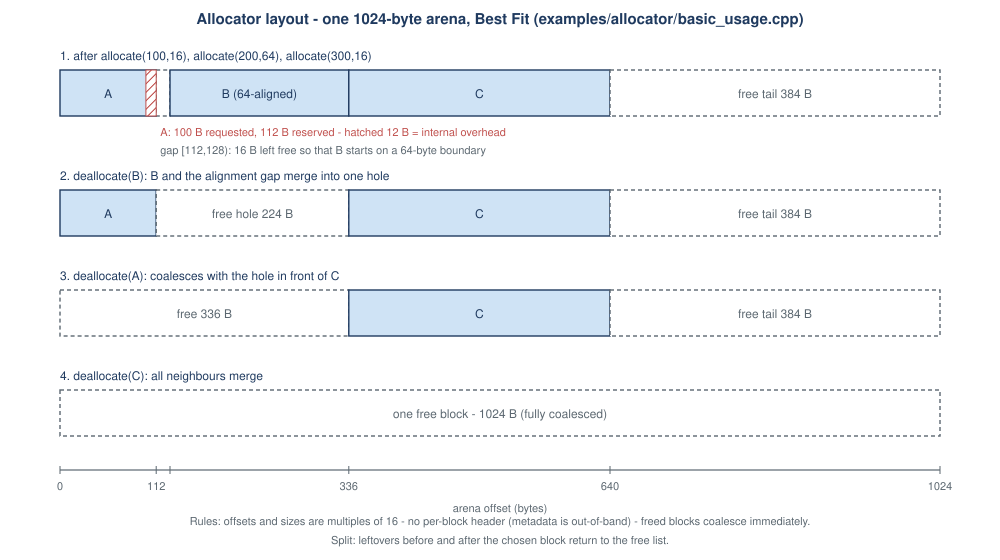

# Allocator design

## Scope

`FreeListAllocator` manages one contiguous arena that it owns. It does **not** replace `malloc` / `new` and never
touches the host heap beyond reserving the arena once. It is single-threaded by design (see *Limitations*).

## Contract (`MemoryAllocator`)

| Call | Success | Failure codes |
| --- | --- | --- |
| `allocate(bytes, alignment)` | `AllocationHandle{id, offset, requested_size, allocated_size}` | `ZeroSize`, `InvalidAlignment`, `SizeOverflow`, `OutOfMemory` |
| `deallocate(id)` | `Status::success()` | `InvalidHandle` (id never issued), `DoubleFree` (already freed) |
| `stats()` | `AllocatorStats` snapshot | - |
| `diagnose()` / `validate()` | `nullopt` / `true` when every invariant holds | - |
| `memory(id)` | writable `std::span` over the requested bytes | empty span for a non-live id |

A failed call never changes allocator state apart from counters. Only valid requests that cannot be served count as
`failed_allocations`; rejected arguments do not.

## Layout convention (identical for all strategies)

* The arena is one buffer aligned to `kMaxAlignment` (4096), so an offset aligned to *n* is also an aligned address.
* Offsets and sizes are multiples of `kGranularity` (16 bytes). A request for *n* bytes reserves `align_up(n, 16)`.
* There is **no per-block header**: metadata lives outside the arena (see ADR-0002). Internal overhead is therefore
  only granularity rounding, and `AllocatorStats::internal_overhead_bytes()` reports exactly that.
* Alignment is a power of two up to 4096 and is raised to at least 16. The gap in front of an aligned block stays on
  the free list.
* **Splitting:** after choosing a free block, the leftover in front (alignment gap) and behind it return to the free
  list. There is no minimum split size, because leftovers are always at least 16 bytes.
* **Coalescing:** a freed block merges immediately with a free predecessor and/or successor.

## Data structures

| Structure | Purpose | Cost |
| --- | --- | --- |
| `std::map<offset, size>` of free blocks | address-ordered free list; neighbour lookup for coalescing | O(log n) insert / erase |
| `std::unordered_map<id, LiveBlock>` | live allocations | O(1) average |

## Strategies

All three scan the same address-ordered free list; only the selection rule differs.

| Strategy | Rule | Search cost |
| --- | --- | --- |
| First Fit | lowest-address block that fits | stops at first match |
| Best Fit | smallest block that fits (ties: lowest address) | always scans the whole list |
| Worst Fit | largest block that fits (ties: lowest address) | always scans the whole list |

`AllocatorStats::search_steps` counts free blocks examined and is the machine-independent cost measure.

## Invariants checked by `diagnose()`

1. Free and live blocks tile the arena exactly: no overlap, no gap, start at 0, end at capacity.
2. No two adjacent free blocks (immediate coalescing).
3. All offsets and sizes respect the granularity; every live offset respects its alignment (also as an address).
4. `requested <= allocated == align_up(requested, 16)` for every live block.
5. Counters (`live_requested`, `live_allocated`) equal the sums over live blocks; `free + allocated == capacity`.
6. Every live id was issued by the allocator.

## Limitations

* Single-threaded; no synchronisation.
* Metadata uses standard containers that allocate from the host heap, so measured latency includes container cost. This
  affects all strategies equally but makes absolute numbers higher than a header-based design would give.
* The arena has a fixed size; it never grows.
* No size-class, bitmap or segregated-list strategies yet (see the roadmap in the README).
