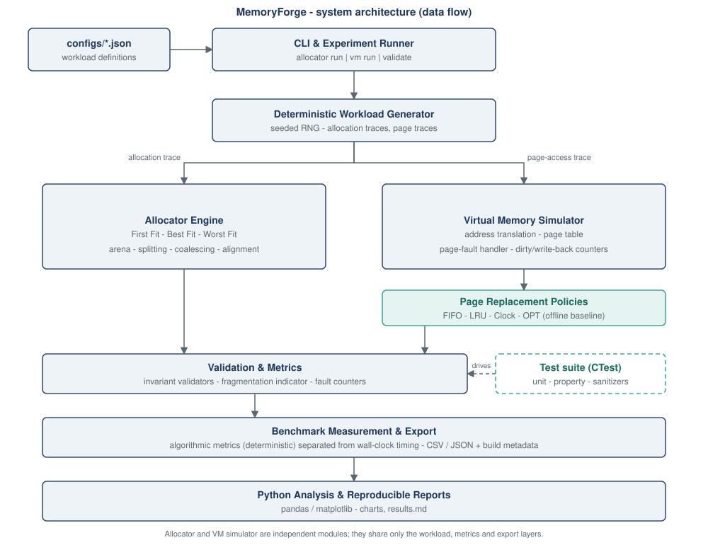
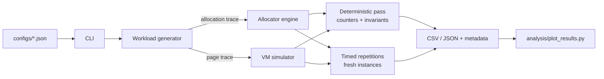

# System overview

MemoryForge is organised as one static library (`memoryforge`) plus a thin command-line executable. Every module is
independent of the CLI, so tests, examples and the CLI all use the same public headers under `include/memoryforge/`.

## Modules

| Module | Headers / sources | Responsibility |
| --- | --- | --- |
| `common` | `common/` | `Result<T>` / `Status` error types, deterministic `Rng`, JSON parser and writer, file I/O |
| `allocator` | `allocator/` | `MemoryAllocator` contract and `FreeListAllocator` (First / Best / Worst Fit) |
| `vm` | `vm/` | `VirtualMemory` simulator and the replacement policies (FIFO, LRU, Clock, OPT) |
| `workload` | `workload/` | Config parsing, seeded trace generation, trace text formats |
| `metrics` | `metrics/` | Fragmentation indicators, latency statistics |
| `benchmark` | `benchmark/` | Replay engines, build metadata, CSV / JSON reports |
| `cli` | `cli/` | `allocator run`, `vm run`, `validate`, `*-trace`, `info` |

The allocator and the virtual-memory simulator never depend on each other. They share only the workload, metrics and
reporting layers.

## Data flow of one experiment

Each run has two passes (see [benchmark-protocol](../experiments/benchmark-protocol.md)):

1. a **deterministic pass** that produces every algorithmic number (failures, search steps, fragmentation, page
   faults) and optionally checks invariants;
2. **timed repetitions** on fresh instances that produce latency and throughput.

## Error handling

Expected failures (bad arguments, out of memory, double free, invalid configs) are values: functions return
`Result<T>` or `Status` carrying an `ErrorCode` and a message. Exceptions are reserved for programming errors such as
reading the value of a failed `Result`, and for `std::bad_alloc` from the host, which `FreeListAllocator::create`
converts into `ErrorCode::OutOfMemory`.

## Determinism

Seeded workloads use MemoryForge's own xoshiro256** generator and bounded sampling instead of `<random>`
distributions, whose output is not specified bit-for-bit across standard libraries. A test pins the first generator
outputs, and every report stores an FNV-1a checksum of the generated trace.
