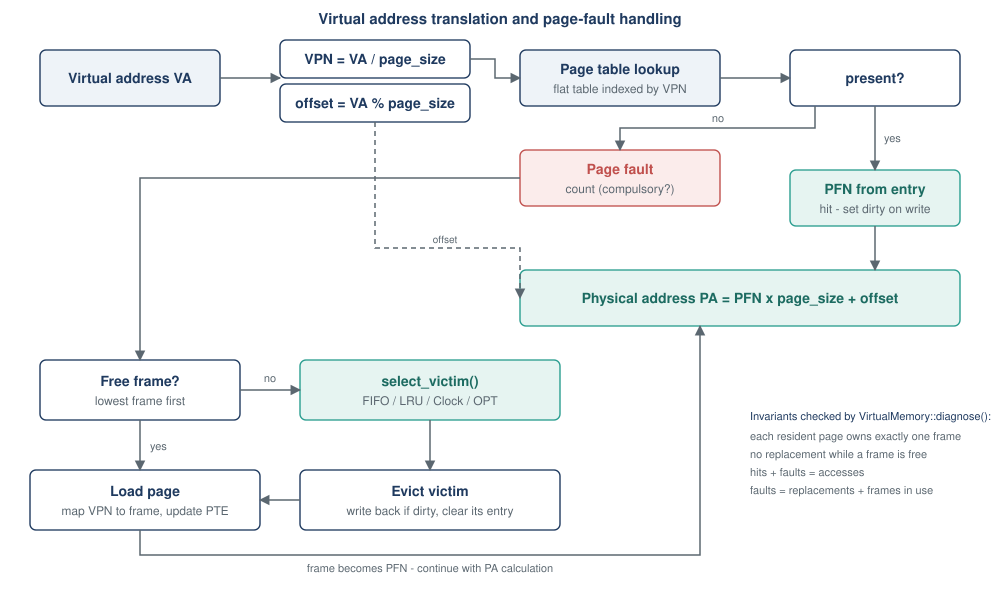

# Virtual-memory simulator design



## Scope

`VirtualMemory` simulates the logical architecture of paging. It does **not** perform real page faults and does not
interact with the host operating system. It models:

* a virtual address space of `virtual_pages` pages of `page_size` bytes (a power of two);
* `frames` physical frames;
* a flat page table with `present`, `dirty` and `frame` per page;
* a pluggable `ReplacementPolicy`;
* page-fault, compulsory-fault, replacement and write-back counters.

## Translation

```
VPN    = VA / page_size            offset = VA % page_size
PA     = PFN * page_size + offset
```

* A hit returns the frame recorded in the page table.
* A fault takes the **lowest-numbered free frame** if one exists. Otherwise the policy chooses a victim, the victim is
  evicted (counted as a write-back if dirty) and its frame is reused. Nothing is replaced while a frame is free.
* A write sets the dirty bit. Dirty state is kept until eviction.
* An address outside the address space returns `ErrorCode::OutOfRange` and leaves all state unchanged.

## Replacement policies

| Policy | Information used | Notes |
| --- | --- | --- |
| FIFO | load order | hits do not change the order; shows Belady's anomaly |
| LRU | recency of every access | `std::list` + hash index, O(1) per access |
| Clock | one reference bit per frame | second-chance approximation of LRU |
| OPT | **the whole future trace** | offline lower bound; precomputes the next use of each reference |

FIFO, LRU and Clock see only the past. `OptimalPolicy` is constructed with the full trace and checks on every access
that the simulator is being driven by exactly that trace; if not, `diagnose()` reports it. Because OPT is a lower bound
on any policy for the same trace and frame count, the project tests `OPT <= every other policy` on fixed and random
traces.

## Invariants checked by `diagnose()`

1. Every resident page maps to a frame, and each frame is owned by exactly one page (no sharing).
2. Frame ownership and the page table agree in both directions.
3. `used frames + free frames == frames`.
4. `hits + faults == accesses` and `reads + writes == accesses`.
5. `faults == replacements + frames in use`, which implies no replacement while a frame was free.
6. `write-backs <= replacements`, `compulsory faults <= faults`.
7. The policy's own consistency check passes.

## Limitations and extensions

* The page table is flat (one entry per virtual page). `metadata_bytes()` reports its size. A multi-level page table
  and a TLB model are natural extensions and are not implemented.
* One address space, no sharing, no pinned pages, no prefetching.
* Dirty/write-back accounting is a counter model; no data is moved.
